# Interval Timer

A low-power workday timer for Android (built for the Pixel 10 / Android 16): start it once in the
morning, put the phone away, and it runs **8 × (50 min work + 10 min break)** on its own.

- **Gong + vibration** at every transition (single gong → break, double → work, long → day done)
- **Home is quick**: Workday 50:10 · Deep 90:15 · Pomodoro 25:5 · Custom (only Custom shows the
  schedule controls), plus **quick timers** for one-off sessions — NSDR, Sketch, Stretch, Exercise,
  Walk, Power nap, Breathing — tapping one counts down 5-4-3-2-1-Start first
- **My library**: your own quick exercises on home, one card each with a thumbnail (YouTube's, a video
  frame or the track's cover art), title, tag label and length. Add a YouTube / YouTube Music link or
  pick an audio / video file; title and length fill themselves in and stay editable; the tag is a
  dropdown of your Toggl and used tags. **Tap starts it at once** (no 5-4-3-2-1): its timer runs and it
  opens in YouTube, YouTube Music (music.youtube.com links) or the app you pick for files.
  Long-press to edit or delete. Synced to Drive (`library.json`)
  - **Share into it**: in YouTube or YouTube Music tap Share -> Interval Timer; the link and its title
    are filled in, you pick a tag and length
  - **MP3 / MP4 files**: share one from Files, Downloads or any app -> Interval Timer. It's kept in the app
    (up to 500 MB) and backed up to your Drive's hidden app folder, so your other phone gets it too.
    It opens in the app you pick ("Play with…")
- **Toggl Track** (Settings): paste your API token (stored encrypted on the phone, never synced). Work
  blocks and break activities start and stop Toggl timers as the phases change; prepare, pauses and
  ambient sounds don't. Pick a Toggl tag, or "Don't send", per activity; library items send their own
  tag. Offline changes are queued and sent later with their real times; Discard deletes that session's
  entries from Toggl too
- **Instagram & YouTube nudges** (Settings): after 5–30 min (your pick, per app) of Instagram or YouTube
  within a rolling window twice that long (e.g. 5 min in the last 10, gaps and all),
  a notification suggests sketching or relaxing instead; its buttons start the Sketch or Breathing
  quick timer. Never while a YouTube video or song is playing (Shorts and browsing do count), at most
  once per 30 min per app. Needs Usage access; for YouTube also Notification access, used only to see
  YouTube's player (on a sideloaded install: App info › ⋮ › Allow restricted settings first). No
  background loop: one inexact alarm set for when the limit could next be reached
- **Start at** a whole hour: the 5th row of the Custom schedule (Now or one of the next four hours);
  the big button then reads "Start at 2:00 PM" and tapping it schedules that start ("Scheduled for
  2:00 PM"); the workday starts by itself then, once. Home shows the armed start with Cancel, and
  "Start now" still starts right away (the daily 10:00
  reminder stays a notification; nothing auto-starts every day)
- **Days this month**: the pill next to your photo counts the days you used the app this month;
  tap it for History
- **Settings** (tap your photo): three pages — **Profile** (account, Drive sync, app updates,
  sign out), **Notifications** (gong / vibration / volume, lock screen, daily reminder, nudges) and
  **Toggl Track**
- **Breaks start with a 2-min prepare phase**; on the break screen you choose the activity (your
  library is there too, folded under "My library")
  and can make it a **long break** (+10 min each tap, also from the notification); the rest of
  the day shifts later. Activities have their own cues:
  - **NSDR** (20 min): plays Yog Nidra or Huberman's NSDR on YouTube Music, picked at random
  - **Stretch** (20 min): one of four 20-min videos, or a guided step routine
  - **Exercise**, **Eye + neck reset**: guided step-by-step with a timer per step
  - **Power nap** (20 min): black screen, hold to wake early; the gong wakes you
  - **Meditation**: sit in silence with a live stillness meter — how quiet you stayed (nothing recorded)
  - **Sketch**: opens [Sketch Seed](https://github.com/shivam1410/sketchseed) (the button shows its app icon)
  - **Refresh**: rain, thunderstorm, ocean, stream, fireplace, whales, white / pink / brown / grey noise (real recordings, see Credits)
  - **Nothing**: no phone, no task — just be
  - Breathing animation, walk
- **Focus music** is picked on the work screen (brown noise, rain, ocean, singing bowls) and
  keeps playing with the screen off
- **Actionable notification** with countdown, Pause and Skip — no need to open the app; on Android 16
  QPR+ it's a **Live Update** (status-bar chip with the countdown, pinned on the lock screen); on
  Android 17 the countdown is shown **big**, like the Clock app's timer, with the break time beside it
- **Overtime**: when a work block or break activity hits 0 it doesn't move on — one gong, then it
  counts up (+00:01…) with the ring filling every minute; **+10 min** for another countdown or
  **Next** when you're done (overtime counts as work). Prepare still flows into the activity
- **Lock-screen page** at every phase change: black-and-white, display only, closes itself after ~12 s
- **Restart-proof**: phases are absolute timestamps, rebuilt after reboot; installing an update mid-session
  keeps the session and resumes its music
- **End and Save / Discard**: one row — Discard (left), Keep going, End and Save (right). End and
  Save keeps what you've done in History; Discard throws the session away. Stretches under a minute (from skipping through unused slots) don't show in the day view
- **Activities**: every break stretch remembers its activity, so a day lists "😌 NSDR 20 min" and History
  shows time per activity (library items included) over the last 30 days. Ambient sounds played
  from home are logged as their own line, not as break time, and sync across phones via Drive
- **History & streaks**: current/best streak, last-7-days focus chart, 12-week consistency heatmap (square cells, every weekday labelled),
  a month calendar, all-time totals. Tap any day for **how the day went**: a
  work/break wave over the hours (pauses as gaps, overtime in its own colour) and every stretch. Time is what you actually spent (skips and pauses don't inflate it); a day
  counts toward the streak once one full work block is finished
- **Google account + Drive sync** (optional): sign in from the avatar on the home screen; history
  syncs to your Drive's private app folder (`drive.appdata`, invisible to you and other apps) and
  merges across phones. Without sign-in it all stays local; Android's built-in Google backup
  still covers settings and history
- **Auto-update** from GitHub Releases

## Screenshots

| Home + quick timers | My library | Add to library (shared link) | Quick-timer countdown |
|:-:|:-:|:-:|:-:|
| 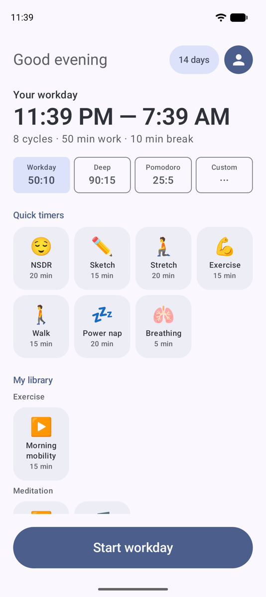 | 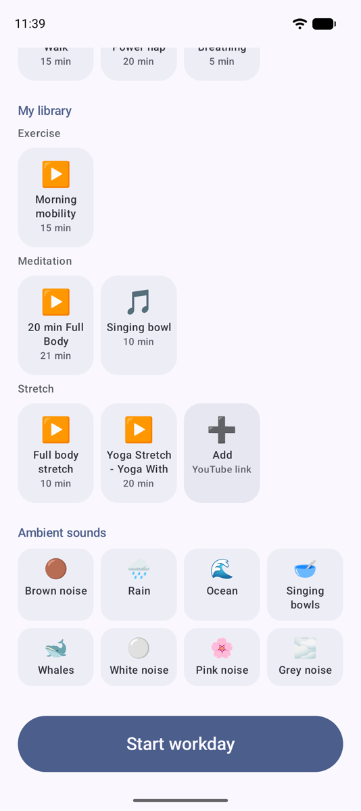 | 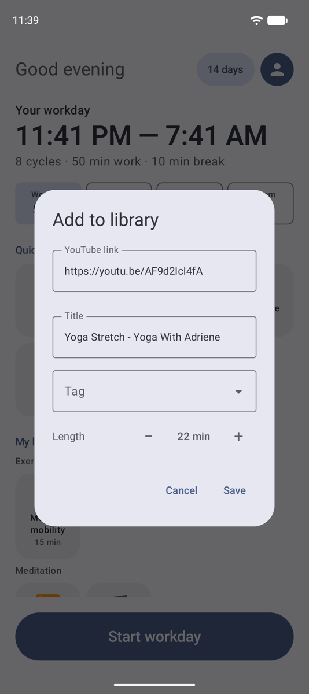 | 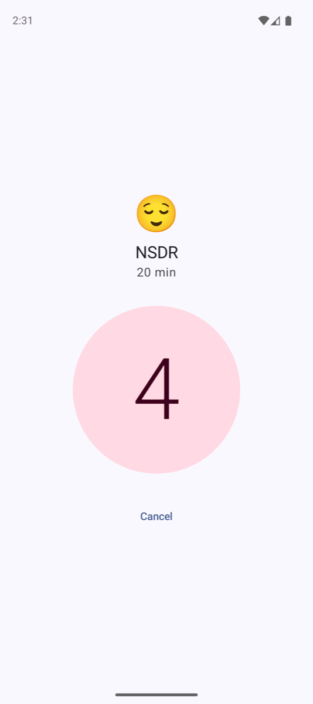 |

| Custom: start at an hour | Work + focus music | Break · pick an activity | End and Save / Discard |
|:-:|:-:|:-:|:-:|
| 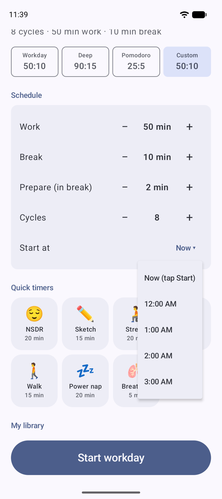 | 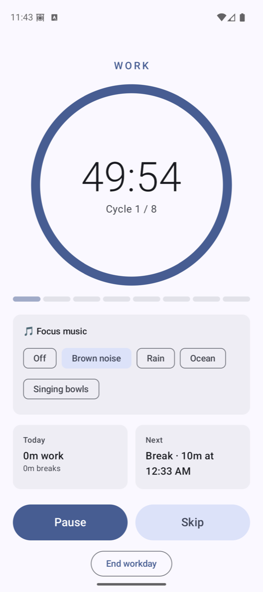 | 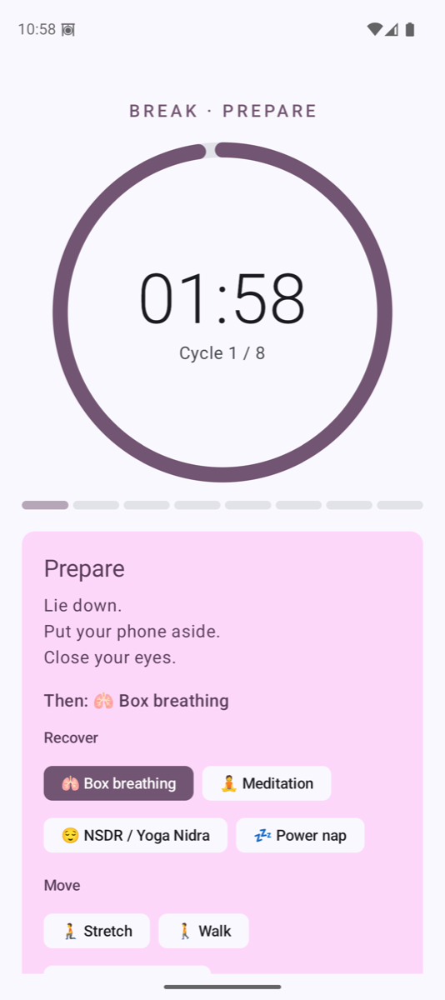 | 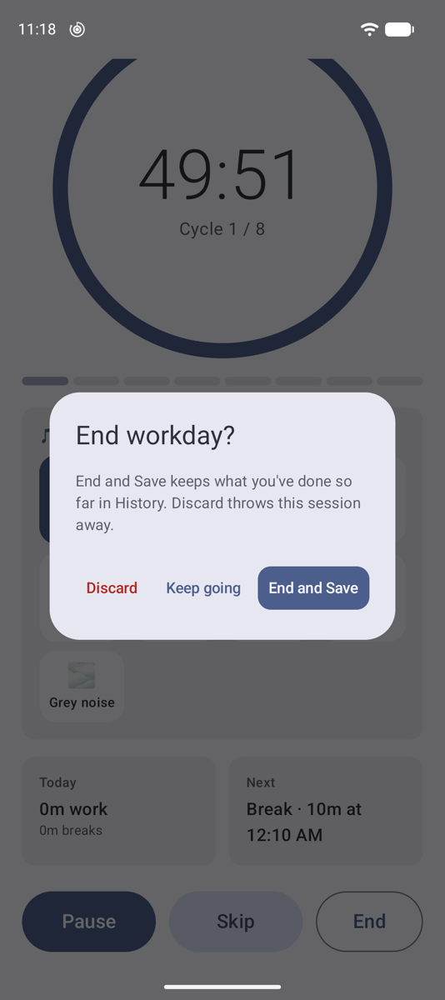 |

| Overtime: counts up at 0 | Lock screen: time's up | Live Update (Android 16 QPR+) | Custom: type a value |
|:-:|:-:|:-:|:-:|
| 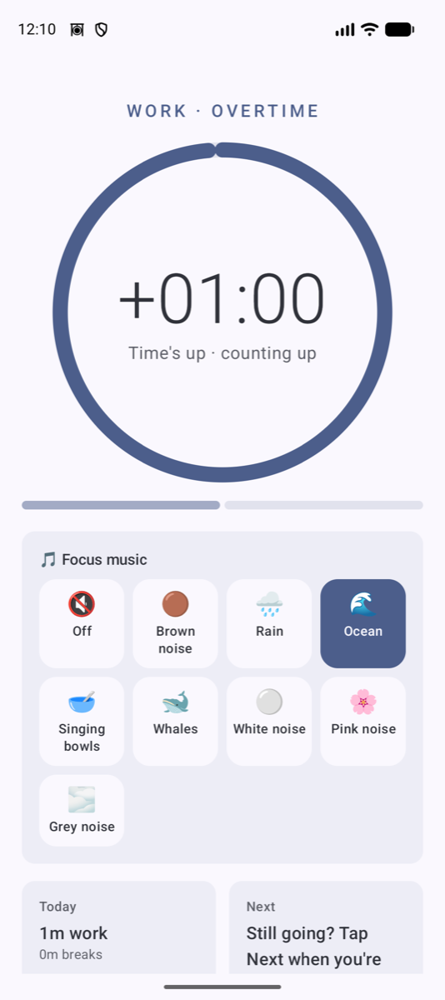 | 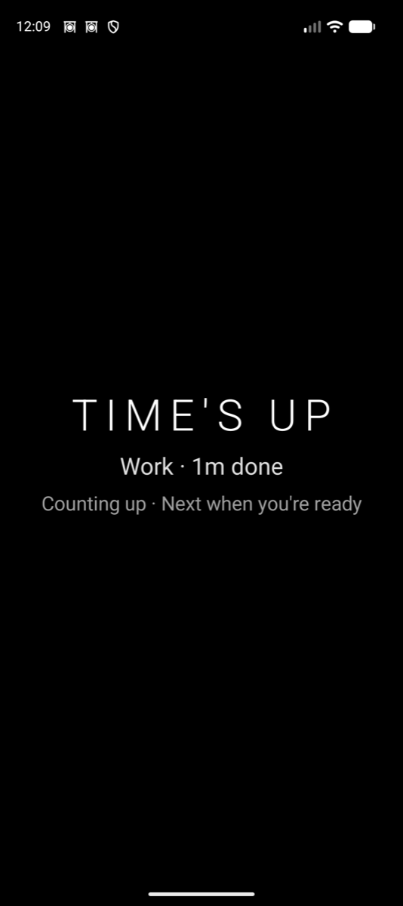 | 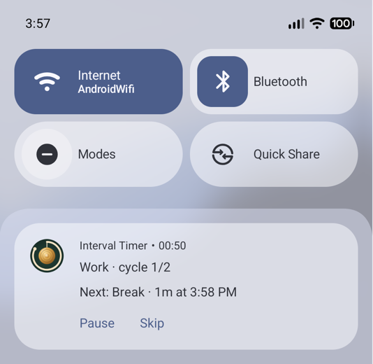 | 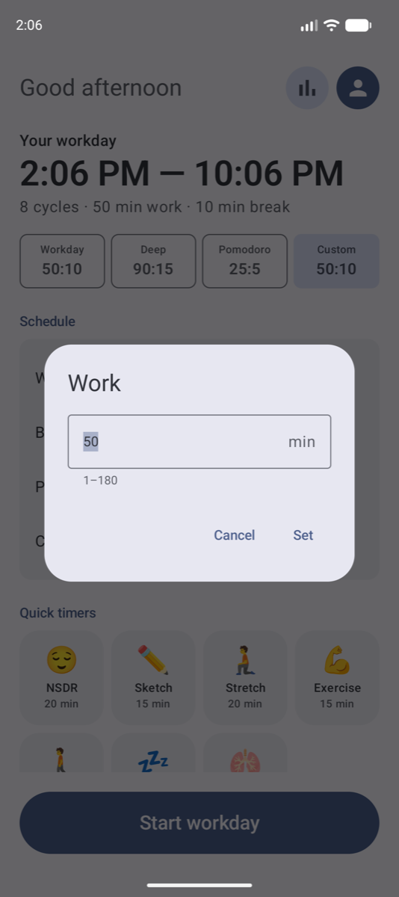 |

| Breathing | History (sample data) | Activities | A day in History (sample data) |
|:-:|:-:|:-:|:-:|
| 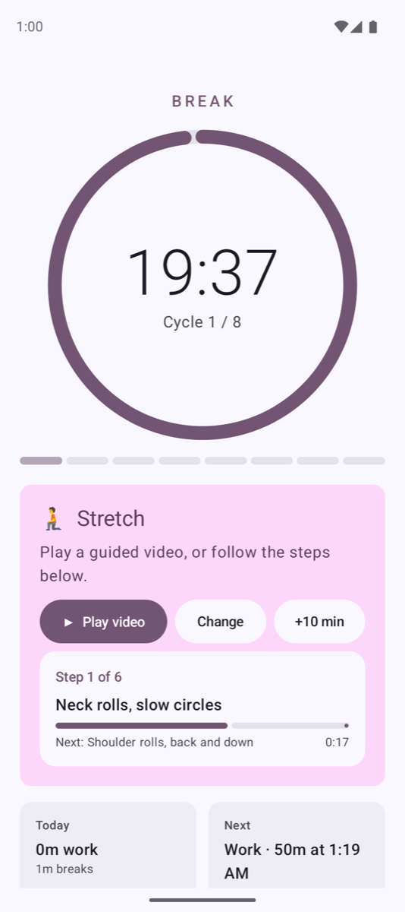 | 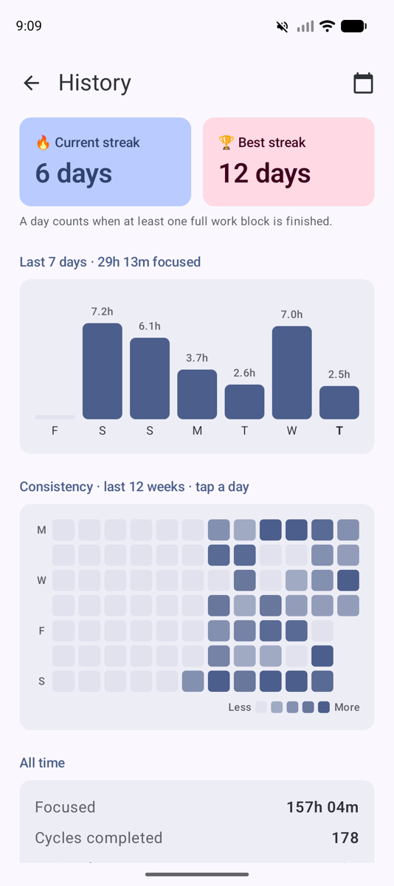 | 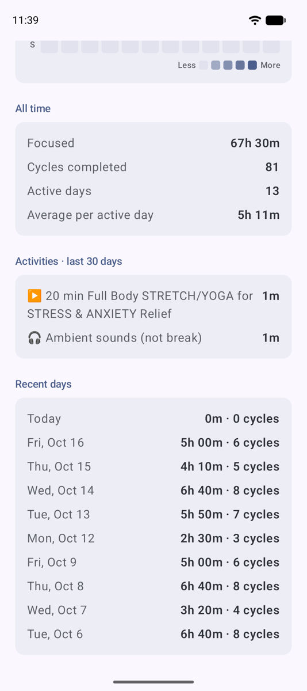 | 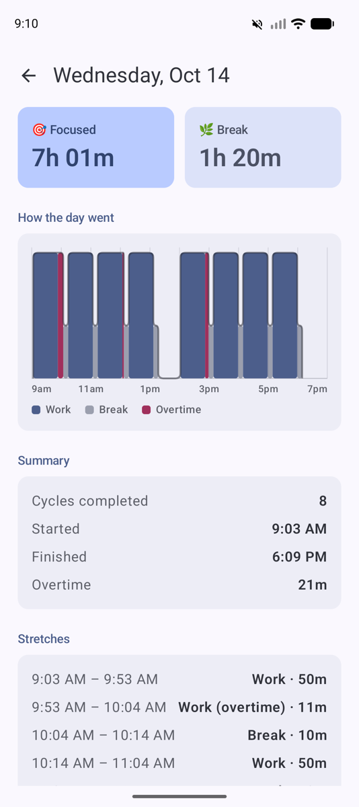 |

| Calendar | Settings | Notifications | Toggl Track |
|:-:|:-:|:-:|:-:|
| 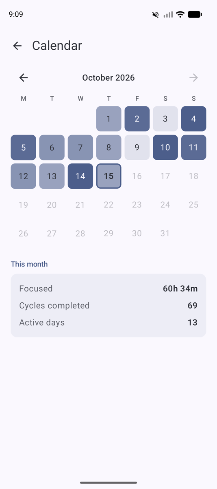 | 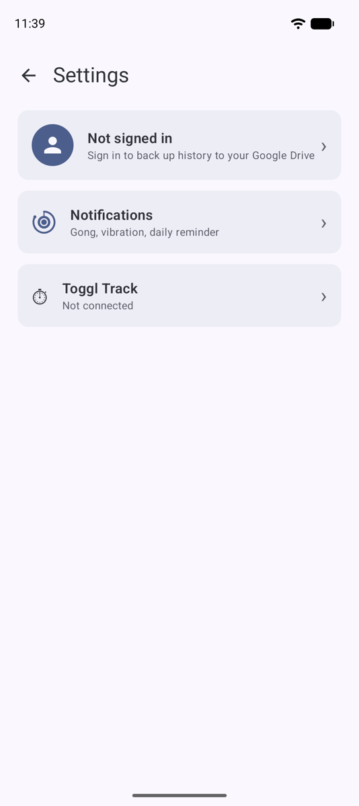 | 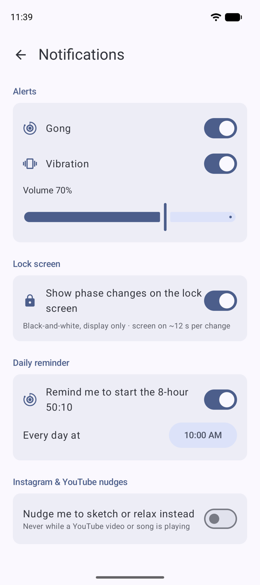 | 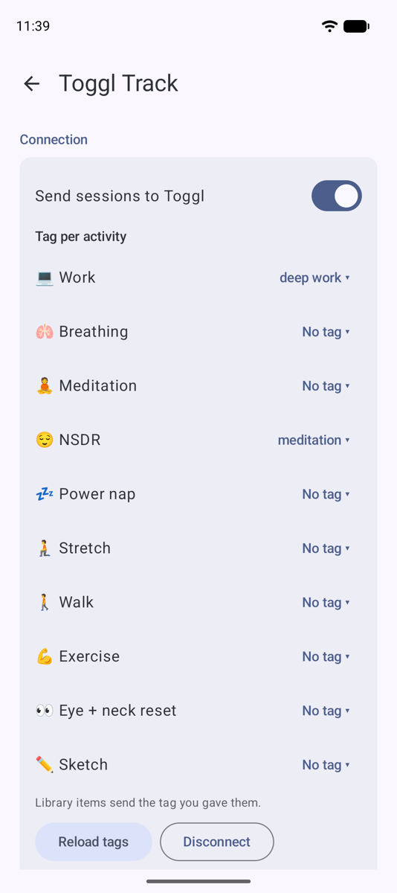 |

| Dark: break |
|:-:|
| 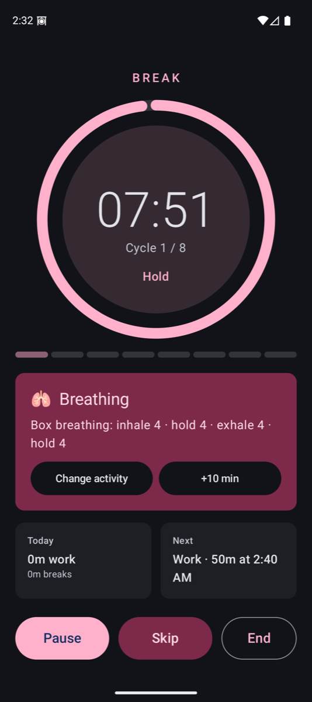 |

Light and dark follow the system theme, with Material You colours from the wallpaper.

## How it stays light

No background ticking. Each phase end is one `AlarmManager` exact alarm; the notification shows
a system-rendered countdown. A foreground service exists only while audio is playing.

Measured on the emulator with gong and music off: **0.14 s of CPU over 129 s** of a running workday,
including two phase changes and the lock-screen page. The countdown in the notification and the
Live Update chip is drawn by Android, not the app. What does cost battery is optional and visible:
the lock-screen page turns the screen on for ~12 s per phase change (about 5 min a day for a full
8-cycle workday), and focus music plays audio like any music app.

## Resources

Audio is **not bundled in the APK**. [`resources/`](resources) holds the sounds and
`manifest.json`; the app downloads them from this repo on first launch and caches them offline.
Sounds are synthesized by [`tools/gen_sounds.py`](tools/gen_sounds.py), except the nature recordings (see [Credits](#credits)). To add a sound, drop a file
in `resources/` and add an entry to `manifest.json` (`"loop": true` makes it selectable as music).

## Google Drive sync setup (one-time, Google Cloud Console)

1. Enable **Google Drive API** for the project.
2. **OAuth consent screen**: External, status *Testing*, add your Gmail as a test user, add scope
   `https://www.googleapis.com/auth/drive.appdata`.
3. **Credentials → OAuth client ID → Android**, package `com.shivam1410.intervaltimer`:
   - release key SHA-1 `E5:3B:B2:7B:1B:5B:28:1D:BC:17:A0:56:5E:4E:99:95:66:49:5A:85`
   - (optional, for debug builds) a second client with the debug key SHA-1 from
     `keytool -list -v -keystore ~/.android/debug.keystore -storepass android`

No Web client or API key is needed: the app uses Google's `AuthorizationClient`, which returns the
Drive token and your name/photo in one consent.

## Credits

Real recordings in `resources/` (everything else there is synthesized by `tools/gen_sounds.py`), all from
Wikimedia Commons:

- **Rain** — [“Bourne woods rain 2020-05-10 0800”](https://commons.wikimedia.org/wiki/File:Bourne_woods_rain_2020-05-10_0800.mp3)
  by **Robert EA Harvey**, [CC BY-SA 4.0](https://creativecommons.org/licenses/by-sa/4.0/); used unmodified.
- **Thunderstorm** — [“Thunderstorm after hot summer day 17 minutes 02 of 04”](https://commons.wikimedia.org/wiki/File:Thunderstorm_after_hot_summer_day_17_minutes_02_of_04.ogg)
  by stephan, public domain; its Ogg Skeleton stream removed (Android's player rejects it), audio untouched.
- **Ocean** — [“Ocean Waves on a Tropical Beach”](https://commons.wikimedia.org/wiki/File:Ocean_Waves_on_a_Tropical_Beach.ogg)
  by Jarrod Stanley, [CC0](https://creativecommons.org/publicdomain/zero/1.0/).
- **Stream** — [“stream-river-water-up-close”](https://commons.wikimedia.org/wiki/File:433589_jackthemurray_stream-river-water-up-close.wav)
  by jackthemurray, [CC0](https://creativecommons.org/publicdomain/zero/1.0/); converted to AAC.
- **Fireplace** — [“Campfire sound ambience”](https://commons.wikimedia.org/wiki/File:Campfire_sound_ambience.ogg)
  by **Glaneur de sons**, [CC BY 3.0](https://creativecommons.org/licenses/by/3.0/); used unmodified.
- **Whales** — [“Whales and Dolphins, Nueva Esparta”](https://commons.wikimedia.org/wiki/File:Whales_and_Dolphins_whale_nature_sounds_songs_nueva_esparta.ogg)
  by Wilfredo R. Rodriguez H., [CC0](https://creativecommons.org/publicdomain/zero/1.0/) (public domain).

## Build & release

```bash
./gradlew testDebugUnitTest assembleDebug
scripts/release.sh 1.0.1 "What changed"
```

`release.sh` bumps `VERSION_NAME`, builds a signed APK, tags, pushes and creates the GitHub
release. The installed app checks `releases/latest` on launch, downloads a newer APK and offers
**Install**. Signing reads `IT_STORE_FILE`, `IT_STORE_PASSWORD`, `IT_KEY_ALIAS`, `IT_KEY_PASSWORD`
from `~/.gradle/gradle.properties`; the keystore stays out of git — **back it up**, every update
must be signed with the same key.
